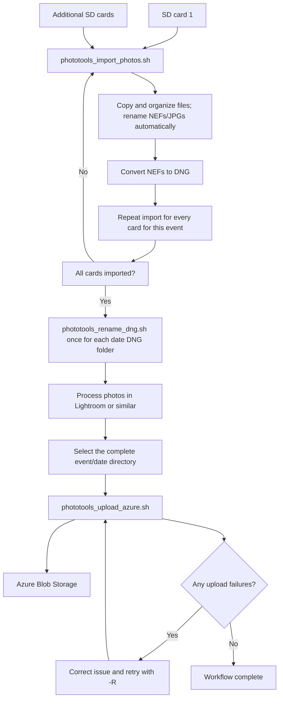

# photo-tools

A collection of photo management tools, grouped into directories by purpose.

Licensed under the [MIT License](LICENSE).

Some tools also have PowerShell versions for Windows 11; see [Windows 11 (PowerShell)](#windows-11-powershell) for the available scripts and their options.

> **Production location:** In normal use the tools are installed with `install/install.sh` and run from **`/usr/local/bin`**, by name (e.g. `phototools_import_photos.sh -e "My Event"`). The exception is when they were installed somewhere else with `install/install.sh -d DIR`; then they run from that folder. This repository is the source; the `workflow/...` paths below show where each script lives in the repo, not where it runs from.

---

## Note from the author

I created this repository of tools to assist in my personal photography workflow. I primarily use Mac computers, Nikon cameras, Lightroom, and Azure so those are well tested. I have tested the Windows 11 versions of these tools as well but no other cameras or photo processing software. Please use the software as you wish while maintaining my copyright. There are no warranties implied with this release. I will review pull requests from those that wish to contribute features. Please submit issues if you run into trouble or have a question. Most of this code was generated with the assistance of AI but thoroughly tested by me, a human, personally.

---

## Supported Platforms

|Platform|Version|Testing Notes|
|---|---|---|
|Mac OS X|Golden Gate 27.2.1|Command-line version running ZSH|
|Microsoft Windows|Microsoft Windows 11 Pro|PowerShell version 7. Not all commands are supported.|

## Repository layout

```
photo-tools/
├── README.md                 # this file
├── install/
│   ├── install.sh            # installs prerequisites, then copies every tool script into /usr/local/bin
│   ├── uninstall.sh          # removes installed tools and Stream Deck launchers
│   └── install.ps1           # Windows installer
├── stream-deck/              # .command launchers for Stream Deck
├── workflow/                 # post-shoot workflow: SD card import and file organization
│   ├── phototools_import_photos.sh      # PRIMARY: import an SD card after a shoot (copy, rename, DNG)
│   ├── phototools_import_photos.ps1      # Windows version
│   ├── phototools_rename_nef.sh         # rename NEFs/JPGs to capture time (used by phototools_import_photos.sh)
│   ├── phototools_rename_nef.ps1         # Windows version
│   └── phototools_rename_dng.sh         # rename DNGs by capture date, event and serial
├── cloud/                    # cloud backup and sharing
│   ├── phototools_upload_azure.sh       # upload folders to Azure Blob containers, with a retry folder for failures
│   ├── phototools_upload_azure.ps1      # Windows version
│   ├── phototools_report_azure.sh       # read-only Azure Blob account statistics and Excel reports
│   ├── phototools_prune_nef.sh          # archive (or delete) NEF.zip files and NEFs in Azure Blob Storage
│   ├── phototools_archive_container.sh  # move a whole named Azure Blob container to the Archive tier
│   └── phototools_unarchive_container.sh # move an archived Azure Blob container back to Hot (or Cool/Cold)
└── tools/                    # dependency management
  ├── phototools_prereqs.sh            # checks for / installs required tools (via Homebrew)
  ├── phototools_prereqs.ps1           # Windows: via winget
  ├── phototools_update.sh             # updates Homebrew-managed dependencies
  └── phototools_update.ps1            # Windows: updates winget-managed dependencies
```

| Directory   | Purpose                                                            |
|-------------|--------------------------------------------------------------------|
| `install/`  | Installing the tools on a Mac or Windows PC (not a tool itself).   |
| `stream-deck/` | Launchers for running photo imports from Stream Deck.           |
| `workflow/` | Getting photos off the camera and into the archive after a shoot.  |
| `cloud/`    | Copying photos to cloud storage.                                   |
| `tools/`    | Checking, installing, and updating dependencies.                   |

### Adding new tools

- Give each tool a `-v` option that shows what it is doing; it is off by default.
- Put each tool in a top-level directory named for its purpose (e.g. `workflow/`). Create a new directory when a tool doesn't fit an existing one.
- `install/install.sh` picks up every `*.sh` one level down and every `stream-deck/*.command`; `install/install.ps1` picks up every `*.ps1` one level down. Script names must be unique within each destination.
- Keep scripts that call each other in the same directory — `phototools_import_photos.sh` finds `phototools_rename_nef.sh` by looking next to itself, as does the PowerShell version.
- If a new tool needs another program, add a check for it to `tools/phototools_prereqs.sh` or `tools/phototools_prereqs.ps1`, as appropriate.
- Add the tool to the tree and table above, and give it a section under [Tools](#tools).

---

## Workflow

Use this procedure for each event: import all of its SD cards, rename the DNGs
once importing is complete, process the photos in Lightroom or a similar
application, then upload the complete event or date directory to Azure. The
import script automatically calls `phototools_rename_nef.sh` to name NEFs and JPGs; run
`phototools_rename_dng.sh` after all cards have been imported to give the DNGs their final
date-event-serial names.



### Procedure

1. **Prepare the archive destination.** Connect the destination disk and set it
   for this shell, or pass it with `-d` on each import command:
   ```bash
   export PHOTO_IMPORT_DEST="/Volumes/photos-01"
   ```
2. **Import every SD card for the event.** Use the same event name and
   destination for each card. Preview and then import the first card:
   ```bash
   phototools_import_photos.sh -e "Detroit Riverwalk" -n
   phototools_import_photos.sh -e "Detroit Riverwalk" -x
   ```
   For another card from the same event, identify its mount point with `-s` and
   run the import again:
   ```bash
   phototools_import_photos.sh -e "Detroit Riverwalk" -s /Volumes/BACKUP -x
   ```
   Repeat until all cards for the event have been imported. Importing cards
   separately lets the DNG serials continue from existing files and uses the
   import manifest to avoid importing the same files twice.
3. **Rename DNGs after importing all cards.** For each date folder containing
   DNGs, preview and then run `phototools_rename_dng.sh`. This renames them to
   `YYYYMMDD-event-NNNNN.dng`; the serial continues after the highest existing
   number for that date and event.
   ```bash
   phototools_rename_dng.sh -n -e "Detroit Riverwalk" "$PHOTO_IMPORT_DEST/20261017/DNG"
   phototools_rename_dng.sh -e "Detroit Riverwalk" "$PHOTO_IMPORT_DEST/20261017/DNG"
   ```
   Repeat for each date's `DNG/` folder for the event.
4. **Process the photos.** Open the complete event or date directory in
   Lightroom or another photo application and do your selection, editing, and
   other post-processing. Keep the directory structure together so the NEF,
   JPG, DNG, and any generated files remain part of the same event/date archive.
5. **Upload the complete event/date directory to Azure.** Do this after photo
   processing. Sign in with `az login` if using your user identity, then set the
   upload source to the directory containing the entire event/date, including
   its subfolders—not just `DNG/`, `NEF/`, or `JPG/`. Set `PHOTO_AZ_ACCOUNT`
   once in your shell profile or pass `-a`.
   ```bash
   phototools_upload_azure.sh -a ACCOUNT -u detroit-riverwalk="$PHOTO_IMPORT_DEST/20261017"
   ```
   Replace the example path with the complete event/date directory you want
   backed up. The container must already exist and the identity needs the
   **Storage Blob Data Contributor** role. Uploading skips blobs already present.
6. **Retry any failures.** The upload reports failed files and keeps their
   originals in place. Correct the reported issue, then rerun the same upload
   mapping with `-R`:
   ```bash
   phototools_upload_azure.sh -a ACCOUNT -u detroit-riverwalk="$PHOTO_IMPORT_DEST/20261017" -R
   ```
   Repeat until the upload completes without failures.

See the individual tool sections below for all options, naming behavior,
prerequisites, and Azure authentication details.

## Tools

> **Primary import tool:** `workflow/phototools_import_photos.sh` processes a camera SD
> card. It calls `phototools_rename_nef.sh` automatically; see the [Workflow](#workflow)
> section for the complete import-to-cloud procedure.

### `workflow/phototools_import_photos.sh` — Import and organize photos from an SD card

**Workflow:**
1. **Copy** — Every file in the card's DCIM folder is copied (never moved; the card is left untouched) into folders by capture date and file type (`20261017/NEF/`, `20261017/JPG/`, …), and each copy is verified. Each date folder also gets an empty `prod/` folder next to `NEF/` and `DNG/`; if `prod/` already exists it is left exactly as it is.
2. **Rename** — Newly imported NEFs and JPGs are renamed to their capture time with `phototools_rename_nef.sh`, so they sort chronologically. Timestamp filenames always include subseconds: missing EXIF values become `00`, and one-digit values are right-padded to two digits. Their EXIF camera Make and Model are included by default; other types (MOV, …) keep their camera names.
3. **Convert** — NEFs are converted with Adobe DNG Converter into the date folder's `DNG/`, using each NEF's date-time-camera filename stem. Conversion and copyright stamping are unchanged.
4. **Copyright** — If a copyright owner is set (see [Copyright](#copyright)), each new DNG is stamped `© <year> <owner>`, with the year taken from that photo's capture date. NEFs are never modified.
5. **Compress** — Once a date's NEFs are all converted and filed, its `NEF/` folder is zipped into `20261017/NEF.zip`, the zip is tested, and the `NEF/` folder is removed. Turn this off with `-z` or `PHOTO_COMPRESS_NEF=0`. It is skipped with `-k` (no DNGs were made) and while any NEF of that date is still waiting for a retry. If a later card adds NEFs to a date that already has a `NEF.zip`, the zip is unpacked first (so duplicates are still caught) and then re-zipped.
6. **Deduplicate** — A manifest prevents re-importing the same file (e.g. re-inserting a card or importing the camera's backup slot), and byte-identical NEFs and JPGs are dropped before filing, so a photo is never stored twice or given two DNGs.

**RAW+JPEG shots:** when the camera records both `DSC_0001.NEF` and `DSC_0001.JPG` for the same picture, both are copied, to `NEF/` and `JPG/`, and renamed to matching camera-aware stems by default (e.g. `2026101710000050-Nikon-Z-8.NEF` and `.JPG`). Only NEFs are converted, so the DNG always comes from the NEF; the JPG is kept as-is, and JPEG-only shots get no DNG.

**Usage** (installed in `/usr/local/bin`):
```bash
phototools_import_photos.sh -e EVENT [options]

Required:
  -e EVENT     event name ("Detroit Riverwalk" -> detroit-riverwalk)

Options:
  -c OWNER     copyright owner written into each new DNG, e.g. "Richard Sedlak"
               (default: $PHOTO_COPYRIGHT_OWNER; no copyright if neither is set)
  -s SOURCE    card mount point (default: the volume in /Volumes that has a DCIM folder)
  -d DEST      destination root (required unless PHOTO_IMPORT_DEST is set)
  -m           explicitly include the EXIF camera Make and Model in filenames (default: on)
  -today       import only files captured today (use file timestamp if EXIF
               date is missing)
  -D YYYYMMDD  put everything in this one date folder instead of sorting by capture date
  -V           verify copies byte-for-byte (default: size check)
  -k           copy and rename only; skip DNG conversion (and NEF compression)
  -z           do not zip the NEF/ folders afterwards (default: zip them)
  -F           force: ignore the manifest and copy everything again
               (identical photos are still never converted twice)
  -x           eject the card when finished
  -n           dry run: show what would happen, change nothing
               (with more than 500 files it warns that this can take several
               minutes and asks whether to continue)
  -v           verbose: show the settings and what is done with each file
               (default: off; not the same as -V)

Environment overrides:
  PHOTO_IMPORT_DEST  destination root (same as -d; -d overrides it)
  PHOTO_COPYRIGHT_OWNER  default copyright owner (same as -c)
  PHOTO_COMPRESS_NEF  set to 0 (or no/false/off) to not compress NEF/ folders (same as -z)
  DNG_CONVERTER  path to the converter binary
                 (default: /Applications/Adobe DNG Converter.app/Contents/MacOS/Adobe DNG Converter)
  DNG_OPTS       converter options (default: "-c -p1" = lossless compressed, medium preview)
```

**Examples:**
```bash
# Set a destination once for repeated imports
export PHOTO_IMPORT_DEST="/Volumes/photos-01"

# Preview what will happen
phototools_import_photos.sh -e "Detroit Riverwalk" -n

# Preview only photos captured today
phototools_import_photos.sh -e "Detroit Riverwalk" -today -n

# Camera Make and Model are included by default in NEF, JPG and DNG filenames
phototools_import_photos.sh -e "Detroit Riverwalk" -n

# Import, then eject the card
phototools_import_photos.sh -e "Detroit Riverwalk" -x

# Second card from the same shoot: DNG numbering continues where the first card left off
phototools_import_photos.sh -e "Detroit Riverwalk" -s /Volumes/BACKUP -x

# Override PHOTO_IMPORT_DEST for one import
phototools_import_photos.sh -e "Detroit Riverwalk" -d /Volumes/alternate-archive -n
```

**Resulting archive layout:**
```
/path/to/destination/
├── .photo-import-manifest.tsv     # every file imported so far (prevents re-imports)
├── 20261017/
│   ├── NEF.zip                    # raw files, timestamp-camera names
│   │                              # (a NEF/ folder instead with -z, -k, or PHOTO_COMPRESS_NEF=0)
│   ├── JPG/                       # JPEGs, renamed the same way (a RAW+JPEG pair shares a name)
│   │   └── 2026101720184537-Nikon-Z-8.JPG
│   ├── MOV/                       # other types keep their camera names
│   ├── DNG/                       # converted files, numbered per date + event
│   │   └── 2026101720184537_Nikon-Z-8.dng
│   └── prod/                      # created empty; never written to by the script
└── 20261018/
    └── ...
```

#### Copyright

Set your name once in `~/.zshrc` so every import stamps it automatically:

```bash
export PHOTO_COPYRIGHT_OWNER="Richard Sedlak"
```

`-c "Name"` overrides it for a single import. For a photo captured 2026-10-17, each new DNG gets:

| Tag                                       | Value                    |
|-------------------------------------------|--------------------------|
| EXIF `Copyright`, XMP `dc:rights`         | `© 2026 Richard Sedlak`  |
| EXIF `Artist`, XMP `dc:creator`           | `Richard Sedlak`         |
| XMP `xmpRights:Marked`                    | `True` (copyrighted)     |

These are the fields Lightroom shows as Copyright, Creator and Copyright Status. IPTC copyright and by-line are updated as well if the file already has IPTC data. The year comes from each photo's capture date, so a New Year's Eve shoot is split between the two years correctly.

- Only DNGs are stamped. The NEFs stay byte-for-byte as they came off the card, and with `-k` (no DNGs) nothing is stamped.
- Only DNGs created by this import are stamped. DNGs imported earlier are left as they are.
- Any copyright the camera wrote (Nikon's *Copyright information* setting) is replaced in the DNG by the `-c` owner.
- If stamping fails, those NEFs are not filed and a re-run retries them, just like a failed conversion.

**Tips:**
- Run with `-n` first to preview.
- Add `-v` to see what the script is doing: the settings in use, why each card file is skipped or imported, each copy, rename (the `phototools_rename_nef.sh` output is shown too), conversion and filing step. These lines start with `verbose:` and go to stderr.
- Long steps show a live status line: files done out of the total, plus amount copied, elapsed time and estimated time left while copying and converting. When the output is redirected to a log file, a progress line is written every 10% instead.
- If an import is interrupted, re-run the same command to finish it.
- Use `-V` for byte-for-byte verification (slower; worthwhile with an unreliable card reader).
- Two events on the same day each get their own DNG number sequence.

---

### `workflow/phototools_rename_nef.sh` — Rename NEF (or JPG) files by capture time

Renames Nikon NEF files (and matching `.xmp` sidecars) using the EXIF `DateTimeOriginal` and `SubSecTimeOriginal` tags. Timestamp names always contain at least two subsecond digits: missing values become `00`, and one-digit values are right-padded (for example, `3` becomes `30`). The EXIF `Make` and `Model` are appended by default, producing names such as `2026101720184537-Nikon-Z-8.NEF`; `-m` explicitly keeps camera naming enabled. Missing camera tags produce a warning and a timestamp-only name. With `-e jpg`, JPGs can be renamed the same way so RAW+JPEG pairs share a name.

```
DSC_0142.NEF -> 2026101720184500-Nikon-Z-8.NEF      (no subseconds; 00 is used)
DSC_0143.NEF -> 2026101720184537-Nikon-Z-8.NEF      (camera naming is default)
DSC_0143.JPG -> 2026101720184537-Nikon-Z-8.JPG      (with -e jpg)
```

**Usage** (installed in `/usr/local/bin`):
```bash
phototools_rename_nef.sh [-n] [-r] [-m] [-v] [-e EXT] DIRECTORY
  -n       dry run: show what would be renamed, change nothing
           (with more than 500 files it warns that this can take several
           minutes and asks whether to continue)
  -r       recurse into subdirectories
  -m       explicitly include the camera Make and Model (default: on)
  -v       verbose: show the metadata each file is named from and why files are
           skipped (default: off)
  -e EXT   rename files with this extension instead of NEF, e.g. -e jpg
           (matches upper and lower case; the extension's case is kept)
```

If two shots share the exact same subsecond, a `_1`, `_2`, … suffix is added. Files without a capture time are skipped.

---

### `workflow/phototools_rename_dng.sh` — Rename DNG files by date, event, and serial

Renames DNG files to `YYYYMMDD-event-NNNNN.dng`. The event is normalized like `phototools_import_photos.sh` (for example, `Detroit Riverwalk` becomes `detroit-riverwalk`). The date comes from EXIF `DateTimeOriginal`, falling back to the file modification date when the tag is missing. Serials continue after the highest existing number for the same date and event.

**Usage** (installed in `/usr/local/bin`):
```bash
phototools_rename_dng.sh [-n] [-r] [-v] -e EVENT DIRECTORY
  -n       dry run: show what would be renamed, change nothing
           (with more than 500 files it warns that this can take several
           minutes and asks whether to continue)
  -r       recurse into subdirectories
  -v       verbose: show where each file's date came from and why files are
           skipped (default: off)
  -e EVENT event name, e.g. "Detroit Riverwalk"
```

For example, `IMG_1234.dng` might become `20261017-detroit-riverwalk-00008.dng` if `00007` is already present.

---

### `cloud/phototools_report_azure.sh` — Report Azure Blob Storage usage

Reports blob counts and total sizes for every container in a storage account. Sizes are reported in gigabytes (GB). It only lists containers and blobs; it does not create, change, or delete anything in Azure. The default summary is printed to the terminal. Detail mode writes an Excel workbook with an overall **Summary** tab first, followed by one tab per container containing each blob's name, size in GB, last-modified time, blob type, content type, and access tier.

**Access:** By default, the report uses your existing `az login` identity. You can also use a service principal with `-I sp`, using the same credentials and environment variables as `phototools_upload_azure.sh` (see [Service principal setup](#service-principal-setup)). The identity needs the **Storage Blob Data Reader** role at storage-account scope or a parent scope; container-scoped assignments alone cannot authorize the initial account-wide container listing. The report does not request or store account keys.

**Usage** (installed in `/usr/local/bin`):
```bash
phototools_report_azure.sh -a ACCOUNT [-I user|sp] [-i APP_ID] [-z TENANT] [-K PEM] [-s | -d FILE.xlsx] [-v]

  -a ACCOUNT  storage account name (default: $PHOTO_AZ_ACCOUNT)
  -I user|sp  Azure identity (default: $PHOTO_AZ_AUTH, else user)
  -i APP_ID   service principal app ID (PHOTO_AZ_CLIENT_ID or AZURE_CLIENT_ID)
  -z TENANT   tenant ID (PHOTO_AZ_TENANT_ID or AZURE_TENANT_ID)
  -K PEM      service principal certificate (PHOTO_AZ_CERT_PATH or AZURE_CLIENT_CERTIFICATE_PATH)
  -s          print a summary (default)
  -d FILE     write an Excel workbook with a summary and one tab per container
  -v          show the Azure CLI commands being run
```

For service principal authentication, client secrets come from `PHOTO_AZ_CLIENT_SECRET`, `AZURE_CLIENT_SECRET`, or the macOS Keychain (service `PHOTO_AZ_KEYCHAIN_SERVICE`, default `photo-tools-azure`). Secrets are not accepted as command-line options. The report uses a temporary Azure CLI profile for service principal sign-in, leaving your existing `az login` profile unchanged.

```bash
# Print per-container and account-wide totals
phototools_report_azure.sh -a rpsphotography001

# Save a workbook (the output directory must already exist)
phototools_report_azure.sh -a rpsphotography001 -d ~/Desktop/storage-report.xlsx
```

Relative output paths are resolved from the current terminal directory. The report prints the full path of the workbook it writes.

The tool requires Azure CLI and Python 3. Set `PHOTO_AZ_ACCOUNT` once in your shell profile to omit `-a`.

---

### `cloud/phototools_prune_nef.sh` — Archive or delete unneeded NEFs in Azure Blob Storage

Saves storage cost by pruning raw files that are no longer needed:

1. Every `NEF.zip` blob is pruned.
2. A `.nef` blob is pruned only if a non-empty `.dng` in the same container has the same name apart from the extension, ignoring case. The DNG must be in the same folder or in the `DNG/` folder beside `NEF/`. Unmatched NEFs are kept and counted.

Matching is by name, so run this tool before renaming DNGs with `phototools_rename_dng.sh`. When using `-p`, choose a prefix that includes both the NEF and DNG folders; DNGs outside the prefix are not considered.

**Nothing is changed by default.** The tool lists what it found, then asks once whether to go ahead (it needs a terminal to ask on; without one it stops and changes nothing). Use `-y` to skip the question, or `-n` for a dry run that only reports. By default pruned blobs are moved to the **Archive** access tier (the cheapest tier, but reading a blob again takes hours and has a 180-day minimum charge); blobs already in the Archive tier are skipped. With `-D` they are deleted permanently instead.

The report shows, for each container, each folder with the number of `NEF.zip` and `NEF` blobs to prune and their size, plus totals and the number of unmatched NEFs kept. Add `-l` to list planned and kept blob names.

**Access:** The same sign-in as `phototools_upload_azure.sh`: your `az login` identity, or a service principal with `-I sp` using the same options, environment variables and secret sources (see [Service principal setup](#service-principal-setup)). The identity needs the **Storage Blob Data Contributor** role, and listing all containers needs it at storage-account scope (use `-c` for container-scoped assignments).

**Usage** (installed in `/usr/local/bin`):
```bash
phototools_prune_nef.sh [-a ACCOUNT] [-c CONTAINER ...] [-p PREFIX] [-D] [-n | -y] [-l] [-I user|sp] [-i APP_ID] [-z TENANT] [-K PEM] [-v]

  -a ACCOUNT    storage account name (default: $PHOTO_AZ_ACCOUNT)
  -c CONTAINER  only this container; repeat for several (default: all)
  -p PREFIX     only blobs whose name starts with PREFIX
  -D            delete permanently instead of archiving (the default)
  -n            dry run: report containers, folders and counts, change nothing
  -y            do not ask; archive (or with -D, delete) right away
  -l            list every blob, not just counts
  -I, -i, -z, -K  service principal options, as for phototools_upload_azure.sh
  -v            show the Azure CLI commands being run
```

```bash
# See what would be removed, with file names
phototools_prune_nef.sh -a rpsphotography001 -n -l

# Archive, after one confirmation
phototools_prune_nef.sh -a rpsphotography001 -c charlevoix

# Delete one date folder's NEFs permanently, without asking
phototools_prune_nef.sh -a rpsphotography001 -c charlevoix -p 2026/20261017/ -D -y
```

Exit status: `0` done (or nothing to do, or you declined), `2` some blobs could not be pruned, `1` error.

---

### `cloud/phototools_archive_container.sh` — Archive a whole Azure Blob container

Saves storage cost by moving every blob in one named container to the **Archive** access tier (the cheapest tier, but reading a blob again takes hours and has a 180-day minimum charge). Blobs already in the Archive tier are skipped, as are blobs that cannot be archived (only block blobs can); both are counted in the report. Nothing is deleted.

**Nothing is changed by default.** The tool lists what it found (each folder with its blob count and size, plus totals), then asks once whether to go ahead (it needs a terminal to ask on; without one it stops and changes nothing). Use `-y` to skip the question, or `-n` for a dry run that only reports. Add `-l` to list every blob name.

**Access:** The same sign-in, options, environment variables and secret sources as `phototools_upload_azure.sh` and `phototools_prune_nef.sh` (see [Service principal setup](#service-principal-setup)). The identity needs the **Storage Blob Data Contributor** role.

**Usage** (installed in `/usr/local/bin`):
```bash
phototools_archive_container.sh [-a ACCOUNT] -c CONTAINER [-n | -y] [-l] [-I user|sp] [-i APP_ID] [-z TENANT] [-K PEM] [-v]

  -a ACCOUNT    storage account name (default: $PHOTO_AZ_ACCOUNT)
  -c CONTAINER  the container to archive (required)
  -n            dry run: report folders and counts, change nothing
  -y            do not ask; archive right away
  -l            list every blob, not just counts
  -I, -i, -z, -K  service principal options, as for phototools_upload_azure.sh
  -v            show the Azure CLI commands being run
```

```bash
# See what would be archived
phototools_archive_container.sh -a rpsphotography001 -c charlevoix -n

# Archive, after one confirmation
phototools_archive_container.sh -a rpsphotography001 -c charlevoix
```

Exit status: `0` done (or nothing to do, or you declined), `2` some blobs could not be archived, `1` error.

---

### `cloud/phototools_unarchive_container.sh` — Unarchive a whole Azure Blob container

The reverse of `phototools_archive_container.sh`: moves every blob in one named container that is in the **Archive** tier back to an online tier, **Hot** by default (use `-t` to choose `Hot`, `Cool` or `Cold`). Azure rehydrates archived blobs in the background, which takes hours (up to 15 hours at standard priority), and a blob stays in the Archive tier until that finishes. Blobs that are not in the Archive tier, blobs already being rehydrated, and blobs that cannot be archived (only block blobs can) are skipped and counted in the report. Nothing is deleted.

**Nothing is changed by default.** The tool lists what it found (each folder with its blob count and size, plus totals), then asks once whether to go ahead (it needs a terminal to ask on; without one it stops and changes nothing). Use `-y` to skip the question, or `-n` for a dry run that only reports. Add `-l` to list every blob name.

**Access:** The same sign-in, options, environment variables and secret sources as `phototools_archive_container.sh` (see [Service principal setup](#service-principal-setup)). The identity needs the **Storage Blob Data Contributor** role.

**Usage** (installed in `/usr/local/bin`):
```bash
phototools_unarchive_container.sh [-a ACCOUNT] -c CONTAINER [-t TIER] [-n | -y] [-l] [-I user|sp] [-i APP_ID] [-z TENANT] [-K PEM] [-v]

  -a ACCOUNT    storage account name (default: $PHOTO_AZ_ACCOUNT)
  -c CONTAINER  the container to unarchive (required)
  -t TIER       tier to move the blobs to: Hot, Cool or Cold (default: Hot)
  -n            dry run: report folders and counts, change nothing
  -y            do not ask; unarchive right away
  -l            list every blob, not just counts
  -I, -i, -z, -K  service principal options, as for phototools_upload_azure.sh
  -v            show the Azure CLI commands being run
```

```bash
# See what would be unarchived
phototools_unarchive_container.sh -a rpsphotography001 -c charlevoix -n

# Move to Hot, after one confirmation
phototools_unarchive_container.sh -a rpsphotography001 -c charlevoix

# Move to Cool without asking
phototools_unarchive_container.sh -a rpsphotography001 -c charlevoix -t Cool -y
```

Exit status: `0` done (or nothing to do, or you declined), `2` some blobs could not be moved, `1` error.

---

### `cloud/phototools_upload_azure.sh` — Upload photo folders to Azure Blob Storage

Uploads local folders into Azure Blob Storage containers, one container per category (e.g. `charlevoix`, `grand-haven`), using `azcopy`. Uploads can take hours, so files that fail are moved to a retry folder, and a retry run only uploads those files.

**Workflow:**
1. **Sign in** — as you (your existing `az login`) or as a service principal (`-I sp`, see [Service principal setup](#service-principal-setup)).
2. **Check** — before anything is uploaded, every container is checked: it must exist and the signed-in identity must have access. If a container does not exist, the script asks whether to create it (see `-c`). Problems stop the run with a message naming the missing role.
3. **Authorize azcopy** — by default the script creates a short-lived **user delegation SAS** for each container. The SAS is signed with your Entra ID sign-in, never with storage account keys, so account keys can stay disabled. It allows only read/create/write/list, never delete, and is HTTPS-only and never printed or logged. With `-A oauth`, azcopy signs in itself instead and renews its own tokens. That suits very long uploads, which could outlast a SAS.
4. **Upload** — files under each folder go to its container, except `.NEF` and `.ZIP` files, which are skipped by default (see [Ignoring file extensions](#ignoring-file-extensions) and [Where files go in the container](#where-files-go-in-the-container)):
   - Each first-level subfolder becomes a folder in the container, keeping everything below it.
   - Files sitting directly in the folder go into a `general/` folder.
   - Hidden files and folders (`.DS_Store`, `.incoming/`, …) are skipped.
   - Blobs that are already in the container are skipped, so re-running only sends what is new.
   - Each blob gets an MD5 hash.
   - azcopy uploads in 40 MiB blocks (`--block-size-mb=40`) with no bandwidth cap (`--cap-mbps=0`).
5. **Report and retry** — at the end, every file that could not be uploaded is listed with the reason. A symbolic link to it is created in the retry folder, keeping its folder structure, and its original path is recorded in `retry-manifest.tsv`. The original stays in place.
   - Run the same command with **`-R`** to upload only the retry folder.
  - Each retried file that succeeds has its retry link removed.
   - A file whose name is already taken in the container by a *different* file (different size) counts as a failure, and the existing blob is never replaced unless you use `-O`.

**Usage** (installed in `/usr/local/bin`):
```bash
phototools_upload_azure.sh -a ACCOUNT -u CONTAINER=DIR [-u CONTAINER=DIR ...] [options]

  -a ACCOUNT    storage account name, e.g. rpsphotography001 (default: $PHOTO_AZ_ACCOUNT)
  -u C=DIR      upload folder DIR into container C (repeat for each category)
  -m MAPFILE    read CONTAINER=DIR (or CONTAINER<TAB>DIR) lines from a file
  -p PREFIX     optional extra folder in front of everything uploaded, e.g. 2026
  -r RETRY      retry folder root (default: $PHOTO_UPLOAD_RETRY, else DIR/.upload-retry)
  -R            retry mode: upload only what is in the retry folders
  -e EXTENSIONS comma-separated filename extensions to ignore (default: $PHOTO_UPLOAD_IGNORE_EXTENSIONS, else nef,zip)
  -I user|sp    who signs in: user = your az login, sp = a service principal (default: user)
  -i APP_ID     service principal application (client) ID
  -z TENANT     Entra tenant ID
  -K PEM        service principal certificate (PEM with private key + certificate)
  -A sas|oauth  azcopy uses a SAS this script creates, or signs in itself (default: sas)
  -c ask|yes|no missing container: ask before creating it, create it, or stop (default: ask)
  -t HOURS      SAS lifetime, 1-167 (default 48)
  -T TIER       blob tier: Hot, Cool, Cold or Archive (default: the account's)
  -O            replace a blob when the local file is newer (default: never replace)
  -n            dry run: sign in and check access, show what would be uploaded
                (and which containers would be created); nothing is created
  -v            verbose: show settings, every az/azcopy command and full errors (for debugging)
```

Exit status: `0` everything uploaded (or already there), `2` some files failed and were moved to the retry folder, `1` error (nothing uploaded).

**Ignoring file extensions:** `.NEF` and `.ZIP` files are skipped by default, regardless of case, in both normal and retry runs. Set `PHOTO_UPLOAD_IGNORE_EXTENSIONS` or pass `-e` with a comma-separated list (extensions without dots) to change the list. An empty value disables filtering; for example, use `-e ''` to include all extensions or `-e nef` to ignore only NEF files.

**Choosing the storage account (`-a` / `PHOTO_AZ_ACCOUNT`):** this is the *name* of the Azure storage account that holds your category containers. It's the first part of the account's blob address `https://<name>.blob.core.windows.net`. Storage account names are 3–24 lowercase letters and digits and are unique across all of Azure. Use the bare name, not the URL, the resource group, or a container name. To find it:
```bash
# every storage account you can see, with its resource group
az storage account list --query '[].{name:name, group:resourceGroup, location:primaryLocation}' -o table

# check it's the right one: list its containers (these are your categories)
az storage container list --account-name rpsphotography001 --auth-mode login --query '[].name' -o tsv
```
Or in the Azure portal: **Storage accounts** → the account → its name is the page title. Set it once in `~/.zshrc` so you don't need `-a` each time:
```bash
export PHOTO_AZ_ACCOUNT=rpsphotography001
```

**Choosing who signs in (`-I` / `PHOTO_AZ_AUTH`):** this picks the Azure identity the script signs in as, which is also the identity Azure checks for permission to upload. If it's not set, `user` is used.

| Value  | Signs in as | Use it when | Setup needed |
|--------|-------------|-------------|--------------|
| `user` | **You**, reusing your existing `az login` (run `az login` once; it lasts for weeks). | You run uploads yourself from your own Mac. The simplest choice. | Give your account the *Storage Blob Data Contributor* role (see [Access requirements](#access-requirements-rbac)). |
| `sp`   | A **service principal**: an app identity with its own certificate or client secret. It signs in separately, so your own `az login` is left alone. | Uploads run unattended (a scheduled job, another Mac), or you want an identity that can *only* upload photos, not use your full account. | Create the service principal and set `PHOTO_AZ_CLIENT_ID`, `PHOTO_AZ_TENANT_ID` and a certificate or secret (see [Service principal setup](#service-principal-setup)). |

Being *Owner* of the subscription is not enough for either one: Owner manages the account but can't read or write blobs. The pre-upload check (and `-n`) reports this before anything is uploaded.

**Where files go in the container:** inside each container, every first-level subfolder of the source folder keeps its name. Files directly in the source folder (not in a subfolder) go into a folder called `general`, which is created the first time and added to after that. For `-u grand-haven=~/Export/GrandHaven`:

| Local file                                  | Blob in `grand-haven`        | With `-p 2026`                    |
|---------------------------------------------|------------------------------|-----------------------------------|
| `~/Export/GrandHaven/20261017/DNG/a.dng`    | `20261017/DNG/a.dng`         | `2026/20261017/DNG/a.dng`         |
| `~/Export/GrandHaven/sunsets/b.jpg`         | `sunsets/b.jpg`              | `2026/sunsets/b.jpg`              |
| `~/Export/GrandHaven/c.jpg`                 | `general/c.jpg`              | `2026/general/c.jpg`              |

`-p` is optional: it adds the same extra folder (it can have several levels, e.g. `2026/fall`) in front of every blob. Without it, the subfolders and `general/` sit at the top of the container.

- The dry run (`-n`) lists each file with the blob it will become.
- If the source folder has a subfolder that is itself called `general`, its files go to `general/` too. A loose file with the same name as one in that subfolder would land on the same blob, so the script stops before uploading and lists those files.

**Examples:**
```bash
# Preview: signs in, checks both containers, lists each file and the blob it becomes
phototools_upload_azure.sh -a rpsphotography001 -u charlevoix=~/Export/charlevoix -u grand-haven=~/Export/grand-haven -n

# Upload
phototools_upload_azure.sh -a rpsphotography001 -u charlevoix=~/Export/charlevoix -u grand-haven=~/Export/grand-haven

# Same, but under a 2026/ folder in each container
phototools_upload_azure.sh -a rpsphotography001 -u charlevoix=~/Export/charlevoix -u grand-haven=~/Export/grand-haven -p 2026

# Some files failed: fix the cause, then upload only those
phototools_upload_azure.sh -a rpsphotography001 -u charlevoix=~/Export/charlevoix -u grand-haven=~/Export/grand-haven -R

# Categories kept in a file (one CONTAINER=DIR per line, # comments allowed)
phototools_upload_azure.sh -a rpsphotography001 -m ~/photo-categories.txt
```

**Creating missing containers (`-c`):** when a container does not exist in the storage account, `-c` decides what happens:
- `ask` (default): the script asks `Create it (private)? [y/N]` for each missing container. If you answer no, or there is no terminal to ask on (e.g. a scheduled run), the run stops before anything is uploaded.
- `yes`: missing containers are created without asking, for unattended runs.
- `no`: containers are never created; the run stops if one is missing.

With `-n` nothing is created and nothing is asked; the output says which containers would be created. In retry mode (`-R`) containers are never created, because there is nothing to retry in a container that doesn't exist. Created containers are listed in the run's `report.txt`.

```bash
# Create the container grand-haven if it is missing, without asking
phototools_upload_azure.sh -a rpsphotography001 -u grand-haven=~/Export/grand-haven -c yes
```

**Retry folder layout** (default: inside each source folder; links are hidden from normal uploads):
```
~/Export/grand-haven/
├── 20261017/...                               # files that uploaded stay where they were
└── .upload-retry/
    ├── retry-manifest.tsv                     # container, blob, original path, time, identity, error
    └── grand-haven/                           # links, one per failed blob path
        ├── 2026/20261017/DNG/a.dng -> ~/Export/grand-haven/20261017/DNG/a.dng
        └── 2026/general/c.jpg -> ~/Export/grand-haven/c.jpg
```
Each run also writes `report.txt` (every failure and where the file is now) and azcopy's logs to `~/.photo-tools/upload-runs/<date-time>/` (change it with `PHOTO_UPLOAD_LOGS`).

#### Access requirements (RBAC)

Whoever signs in, you or a service principal, needs this Azure role on the storage account, or on each container you upload to:

| Role                              | Why                                                                   |
|-----------------------------------|-----------------------------------------------------------------------|
| **Storage Blob Data Contributor** | Check the containers, create the user delegation SAS, upload blobs.   |

`Owner` or `Contributor` on the subscription are **not** enough on their own, because they don't include data access. Assign the role (you need *Owner*, *User Access Administrator* or *Role Based Access Control Administrator* to do this):

```bash
ACCOUNT_ID=$(az storage account show -n rpsphotography001 -g rg-photography --query id -o tsv)
az role assignment create --assignee "$(az ad signed-in-user show --query id -o tsv)" \
  --role "Storage Blob Data Contributor" --scope "$ACCOUNT_ID"
```

- New role assignments can take up to 10 minutes to start working.
- Missing containers can be created by the script (`-c`, see below). New containers are private, with no public access. Creating one needs the same role.
- If the storage account has a firewall, your public IP must be allowed.
- Storage account keys (shared key access) are never used and can stay disabled.

#### Service principal setup

A service principal lets the upload run under its own identity instead of yours, for example from a scheduled job or a dedicated Mac. You need:

1. **Permission to create it** — creating an app registration in the tenant (the *Application Developer* role, or app registration left open to users), plus the right to assign roles on the storage account (see above).
2. **The service principal, limited to the storage account** (or to one container, using the container's ID `$ACCOUNT_ID/blobServices/default/containers/<name>` as the scope; repeat `az role assignment create` for each container). A certificate is preferred to a client secret:
   ```bash
   az ad sp create-for-rbac --name photo-tools-uploader \
     --role "Storage Blob Data Contributor" --scopes "$ACCOUNT_ID" \
     --create-cert          # leave out for a client secret (add --years N to set its lifetime)
   ```
   Note the `appId` and `tenant` in the output. With `--create-cert`, the output also gives the path of a PEM file holding the private key and certificate. Don't grant *Contributor* or *Owner*.
3. **Store the credential:**
   - **Certificate (recommended):** move the PEM to `~/.photo-tools/` and run `chmod 600` on it. The script warns if other users can read it. It must be unencrypted (no passphrase).
   - **Client secret:** keep it in the macOS Keychain, where `security` prompts for the secret so it never appears on screen or in shell history:
     ```bash
     security add-generic-password -s photo-tools-azure -a <appId> -w
     ```
     Or export `PHOTO_AZ_CLIENT_SECRET` (or `AZURE_CLIENT_SECRET`) only in the shell where you run the upload. Don't put a secret in `~/.zshrc`. There is deliberately no command-line option for the secret, because command lines show up in `ps` and shell history.
4. **Settings in `~/.zshrc`** (none of these are secret):
   ```bash
   export PHOTO_AZ_ACCOUNT=rpsphotography001
   export PHOTO_AZ_AUTH=sp
   export PHOTO_AZ_CLIENT_ID=<appId>
   export PHOTO_AZ_TENANT_ID=<tenant>
   export PHOTO_AZ_CERT_PATH=~/.photo-tools/photo-tools-uploader.pem   # if using a certificate
   ```
   Then `phototools_upload_azure.sh -u grand-haven=~/Export/grand-haven` signs in as the service principal. Command-line options override these variables.
5. **Renew before it expires** — secrets and certificates expire (one year by default). When sign-in fails because of that, the script says so. Renew with `az ad sp credential reset --id <appId> [--create-cert]`.

**Every setting and where it comes from** (an option beats a `PHOTO_*` variable, which beats the standard `AZURE_*` variable):

| Setting                | Option | Environment variables                                       | Default              |
|------------------------|--------|-------------------------------------------------------------|----------------------|
| Who signs in           | `-I`   | `PHOTO_AZ_AUTH`                                             | `user`               |
| App (client) ID        | `-i`   | `PHOTO_AZ_CLIENT_ID`, `AZURE_CLIENT_ID`                     | —                    |
| Tenant ID              | `-z`   | `PHOTO_AZ_TENANT_ID`, `AZURE_TENANT_ID`                     | —                    |
| Certificate            | `-K`   | `PHOTO_AZ_CERT_PATH`, `AZURE_CLIENT_CERTIFICATE_PATH`       | —                    |
| Client secret          | —      | `PHOTO_AZ_CLIENT_SECRET`, `AZURE_CLIENT_SECRET`, then Keychain | —                 |
| Keychain item          | —      | `PHOTO_AZ_KEYCHAIN_SERVICE`                                 | `photo-tools-azure`  |
| Storage account name   | `-a`   | `PHOTO_AZ_ACCOUNT`                                          | —                    |
| azcopy authorization   | `-A`   | `PHOTO_AZ_TRANSFER`                                         | `sas`                |
| Missing containers     | `-c`   | `PHOTO_AZ_CREATE_CONTAINERS`                                | `ask`                |
| Retry folder root      | `-r`   | `PHOTO_UPLOAD_RETRY`                                        | `DIR/.upload-retry`  |
| Ignored extensions     | `-e`   | `PHOTO_UPLOAD_IGNORE_EXTENSIONS`                            | `nef,zip`            |
| Reports and logs       | —      | `PHOTO_UPLOAD_LOGS`                                         | `~/.photo-tools/upload-runs` |
| Verbose output         | `-v`   | `PHOTO_UPLOAD_VERBOSE=1`                                    | off                  |

If both a certificate and a secret are set, the certificate is used.

**How the service principal is used:**
- The script signs it in with a private, temporary Azure CLI profile (`AZURE_CONFIG_DIR`), deleted when the script ends. Your own `az login` and default subscription are left untouched.
- With `-A oauth`, azcopy signs in as the service principal itself, using its `AZCOPY_SPA_*` variables. These are set only for the azcopy process.

**Tips:**
- Run with `-n` first. It signs in and checks every container, so a missing role or wrong ID shows up before a long upload starts.
- **Debugging:** add `-v` (or set `PHOTO_UPLOAD_VERBOSE=1`) to see what the script is doing. Lines starting with `debug` go to stderr and show:
  - every setting and where it came from (option, environment variable, or default), plus tool versions;
  - each `az`/`azcopy` command as it runs, with its exit code and how long it took;
  - the full error text from `az`, not just the first lines;
  - azcopy's job ID and log file, and how many files ended in each transfer status.

  azcopy also logs at INFO level instead of WARNING. Besides `report.txt` and azcopy's `logs/`, the run folder keeps:
  - `debug.log`: the same debug lines;
  - `outcome-N-<container>.tsv`: each file's size, outcome, azcopy status and HTTP code;
  - `plans/`: azcopy's job plans, so `AZCOPY_JOB_PLAN_LOCATION=<run folder>/plans azcopy jobs show <job ID>` still works afterwards.

  SAS signatures and client secrets are always shown as `REDACTED`/`<hidden>`. With `-n`, debug lines are only shown on screen, since a dry run writes no files.
- If every file fails at once, the cause is usually the network, the account firewall, a missing role, or an expired SAS. The script says so and points at the azcopy log.
- For uploads that may run longer than the SAS lifetime (`-t`, at most 167 hours), use `-A oauth`.
- Ctrl-C stops the upload without moving anything to the retry folder. Re-run the same command; files that already made it are skipped.
- A SAS is passed to azcopy on its command line, so other users on the same Mac could briefly see it with `ps`. It only works on one container, can't delete anything, and expires. A client secret given to `az login` is exposed the same way for a moment. A certificate, or `-A oauth`, avoids both.

---

## Installation (macOS)

### Prerequisites

| Tool                | Needed by                          | Installed by `tools/phototools_prereqs.sh` with     |
|---------------------|------------------------------------|------------------------------------------|
| Homebrew            | installing the tools below         | — (install it yourself from https://brew.sh) |
| exiftool            | `phototools_import_photos.sh`, `phototools_rename_nef.sh` | `brew install exiftool`                  |
| Adobe DNG Converter | `phototools_import_photos.sh`                 | `brew install --cask adobe-dng-converter` (macOS 14+) |
| Azure CLI           | `phototools_upload_azure.sh`                  | `brew install azure-cli`                 |
| azcopy              | `phototools_upload_azure.sh`                  | `brew install azcopy`                    |
| jq                  | `phototools_upload_azure.sh`                  | included with macOS 15+, else `brew install jq` |
| Python 3            | `phototools_report_azure.sh`, `phototools_prune_nef.sh`, `phototools_archive_container.sh`, `phototools_unarchive_container.sh` | `brew install python`                    |

`install/install.sh` requires `cloud/phototools_upload_azure.sh`, checks and installs missing prerequisites first, then copies the tool scripts. Azure CLI, azcopy, and jq are required to run `phototools_upload_azure.sh`; Azure CLI and Python 3 are required for `phototools_report_azure.sh`, `phototools_prune_nef.sh`, `phototools_archive_container.sh` and `phototools_unarchive_container.sh`. To check or install prerequisites on their own:

```bash
tools/phototools_prereqs.sh -n        # check only: report what's missing
tools/phototools_prereqs.sh           # install anything missing
tools/phototools_update.sh             # install missing prerequisites and update Homebrew-managed dependencies
```

Add `-v` to `prereqs.sh`, `update.sh` or `install.sh` for verbose output (how each tool is looked up and which commands are run).

- `tools/phototools_update.sh` upgrades only dependencies managed by Homebrew; macOS-provided `jq` and manually installed DNG Converter copies are left unchanged. After installation, run `phototools_update.sh` from your `PATH`.
- Adobe's DNG Converter installer asks for your password.
- If exiftool is installed but not on your `PATH`, the script says so and shows the line to add to `~/.zprofile`.
- If DNG Converter lives somewhere other than `/Applications`, set `DNG_CONVERTER` to its path; both `tools/phototools_prereqs.sh` and `phototools_import_photos.sh` use it.
- Without DNG Converter, `phototools_import_photos.sh -k` still works (it copies and renames but makes no DNGs).

### Install to `/usr/local/bin`

`/usr/local/bin` is the standard production location for these tools. It is on the default macOS `PATH`, so installed tools run by name from any directory. Run the installer from the repository:

```bash
install/install.sh -n      # preview: report missing prerequisites, show what will be installed
install/install.sh         # install
install/install.sh -v      # install, showing each step (verbose)
```

The installer:
- runs `tools/phototools_prereqs.sh` to install any missing prerequisites, and stops if one can't be installed;
- copies every tool script and the Stream Deck `.command` launchers into `/usr/local/bin`, creating it if needed;
- sets each script to mode `755` (`rwxr-xr-x`): every user can run it, only the owner can change it;
- uses `sudo` only if `/usr/local/bin` isn't writable by you, and asks for your password in that case.

Re-run it after pulling updates; installed copies are replaced. Until you do, `/usr/local/bin` keeps running the older versions.

### Installing to another path

Use `-d DIR` to install somewhere other than `/usr/local/bin`, e.g. `install/install.sh -d ~/bin`. The tools then run from that folder instead. Make sure it is on your `PATH`; the installer warns if it isn't. Install all scripts to the same folder, since `phototools_import_photos.sh` needs `phototools_rename_nef.sh` next to it.

Stream Deck launchers call `phototools_import_photos.sh` by name, so the install directory must also be on the `PATH` available to the launched shell.

### Uninstalling

Run `install/uninstall.sh -n` to preview removal, then `install/uninstall.sh` to remove the installed tools (including old names) and Stream Deck launchers. Use `-d DIR` for a custom installation directory. Prerequisites are not removed.

### Running from the repository (development)

For testing changes before installing them, run the scripts directly from the repository:

```bash
bash workflow/phototools_import_photos.sh -e "My Event"
bash workflow/phototools_rename_nef.sh ~/Pictures/some-folder
```

Both scripts work with the stock macOS bash 3.2.

---

## Windows 11 (PowerShell)

The `.ps1` scripts below are Windows PowerShell versions of the earlier bash tools. They have not yet been updated for all subsequent changes to the macOS versions. Windows versions of DNG renaming, Azure reporting, pruning, archiving, unarchiving, and uninstalling are not yet available. They target Windows PowerShell 5.1 and PowerShell 7+.

| macOS script                | Windows script               |
|-----------------------------|------------------------------|
| `install/install.sh`        | `install/install.ps1`        |
| `tools/phototools_prereqs.sh`          | `tools/phototools_prereqs.ps1`          |
| `tools/phototools_update.sh`           | `tools/phototools_update.ps1`           |
| `workflow/phototools_import_photos.sh` | `workflow/phototools_import_photos.ps1` |
| `workflow/phototools_rename_nef.sh`    | `workflow/phototools_rename_nef.ps1`    |
| `cloud/phototools_upload_azure.sh`     | `cloud/phototools_upload_azure.ps1`     |

PowerShell parameter names are not case-sensitive, so the one-letter bash flags (`-v` and `-V`, `-r` and `-R`, …) can't be reused. The PowerShell scripts take full names instead, e.g. `-EventName`, `-DryRun`. Every script has built-in help: `Get-Help phototools_import_photos.ps1 -Full`.

### Prerequisites (Windows)

| Tool                | Needed by                              | Installed by `tools\phototools_prereqs.ps1` with                     |
|---------------------|----------------------------------------|-----------------------------------------------------------|
| winget              | installing the tools below             | — (included with Windows 11; otherwise install *App Installer* from the Microsoft Store) |
| exiftool            | `phototools_import_photos.ps1`, `phototools_rename_nef.ps1`  | `winget install OliverBetz.ExifTool`                      |
| Adobe DNG Converter | `phototools_import_photos.ps1`                    | `winget install Adobe.DNGConverter`                       |
| Azure CLI           | `phototools_upload_azure.ps1`                     | `winget install Microsoft.AzureCLI`                       |
| azcopy              | `phototools_upload_azure.ps1`                     | `winget install Microsoft.Azure.AZCopy.10`                |

There is no `jq` or `zip`/`unzip` requirement on Windows: PowerShell reads JSON itself, and NEF folders are zipped with .NET.

```powershell
tools\phototools_prereqs.ps1 -CheckOnly   # check only: report what's missing
tools\phototools_prereqs.ps1              # install anything missing
tools\phototools_update.ps1               # install missing prerequisites and update winget-managed dependencies
```

- Some installers (Adobe DNG Converter, Azure CLI) ask for administrator approval with a UAC prompt.
- A program installed during the run may not be on `PATH` until you open a new PowerShell window; the script tells you when that is the case.
- If DNG Converter is installed somewhere other than `C:\Program Files\Adobe\Adobe DNG Converter.exe`, set `DNG_CONVERTER` to the path of `Adobe DNG Converter.exe`; both `tools\phototools_prereqs.ps1` and `phototools_import_photos.ps1` use it.
- Without DNG Converter, `phototools_import_photos.ps1 -SkipDng` still works (it copies and renames but makes no DNGs).

### Install (Windows)

PowerShell only runs scripts that its *execution policy* allows. Windows 11 defaults to `Restricted`, which blocks all `.ps1` files. Allow locally stored scripts once, for your account only:

```powershell
Set-ExecutionPolicy -Scope CurrentUser RemoteSigned
```

If you downloaded the repository as a zip file, Windows marks the files as coming from the internet and `RemoteSigned` still blocks them. Clear the mark once:

```powershell
Get-ChildItem -Recurse -Filter *.ps1 | Unblock-File
```

Then run the installer from the repository:

```powershell
install\install.ps1 -DryRun   # preview: report missing prerequisites, show what will be installed
install\install.ps1           # install
```

The installer:
- runs `tools\phototools_prereqs.ps1` to install any missing prerequisites, and stops if one can't be installed;
- copies every tool script, including `phototools_prereqs.ps1` and `phototools_update.ps1`, into `%LOCALAPPDATA%\photo-tools\bin`, creating it if needed (no administrator rights needed);
- adds that folder to your **user** `PATH`, so the tools run by name from any new PowerShell window (`-NoPath` skips this).

Use `-Destination DIR` to install somewhere else. Install all scripts to the same folder, since `phototools_import_photos.ps1` needs `phototools_rename_nef.ps1` next to it. Re-run the installer after pulling updates; installed copies are replaced.

To run a script straight from the repository without installing it, call it by path, e.g. `.\workflow\phototools_rename_nef.ps1 D:\Photos\20261017\NEF`.

### Settings (Windows)

The environment variables are the same as on macOS. Instead of `~/.zshrc`, set them once for your account and open a new PowerShell window:

```powershell
[Environment]::SetEnvironmentVariable('PHOTO_IMPORT_DEST', 'D:\photos-01', 'User')
[Environment]::SetEnvironmentVariable('PHOTO_COPYRIGHT_OWNER', 'Richard Sedlak', 'User')
[Environment]::SetEnvironmentVariable('PHOTO_AZ_ACCOUNT', 'rpsphotography001', 'User')
```

These settings apply to new PowerShell windows. You can also set them in Windows by searching for **Edit environment variables for your account**, selecting **Environment Variables**, and adding them under **User variables**.

To set a variable only for the current PowerShell window, use `$env:NAME = 'value'`. You can make that assignment run in every PowerShell window by putting it in your PowerShell profile (`notepad $PROFILE`). Don't store secrets in persistent environment variables or your profile; set them only in the window where you need them.

### `phototools_import_photos.ps1` — Import and organize photos from an SD card

Works exactly like [`phototools_import_photos.sh`](#workflowimport_photossh--import-and-organize-photos-from-an-sd-card): copy and verify, rename to capture time, convert to DNG, stamp the copyright, zip the `NEF/` folders, and never import a photo twice. The archive layout is the same (`D:\photos-01\20261017\NEF.zip`, `JPG\`, `DNG\`, `prod\`, …).

```powershell
phototools_import_photos.ps1 -EventName EVENT [options]

  -EventName EVENT       event name (required). "Detroit Riverwalk" -> detroit-riverwalk
  -CopyrightOwner OWNER  copyright owner written into each new DNG
                         (default: $env:PHOTO_COPYRIGHT_OWNER)
  -Source SOURCE         the card: a drive such as E:\ (default: the drive that has a DCIM folder)
  -Destination DEST      destination root (required unless $env:PHOTO_IMPORT_DEST is set)
  -Date YYYYMMDD         put everything in this one date folder instead of sorting by capture date
  -VerifyBytes           verify copies byte-for-byte (default: size check)
  -SkipDng               copy and rename only; skip DNG conversion (and NEF compression)
  -NoCompress            do not zip the NEF folders afterwards
  -Force                 ignore the manifest and copy everything again
  -Eject                 eject the card when finished
  -DryRun                show what would happen, change nothing
```

| macOS option | Windows parameter | | macOS option | Windows parameter |
|--------------|-------------------|-|--------------|-------------------|
| `-e EVENT`   | `-EventName`      | | `-F`         | `-Force`          |
| `-c OWNER`   | `-CopyrightOwner` | | `-x`         | `-Eject`          |
| `-s SOURCE`  | `-Source`         | | `-n`         | `-DryRun`         |
| `-d DEST`    | `-Destination`    | | `-V`         | `-VerifyBytes`    |
| `-D YYYYMMDD`| `-Date`           | | `-k`         | `-SkipDng`        |
| `-z`         | `-NoCompress`     | |              |                   |

Environment overrides are `PHOTO_IMPORT_DEST`, `PHOTO_COPYRIGHT_OWNER`, `PHOTO_COMPRESS_NEF`, `DNG_CONVERTER` (default `C:\Program Files\Adobe\Adobe DNG Converter.exe`) and `DNG_OPTS` (default `-c -p1`).

```powershell
# Preview what will happen
phototools_import_photos.ps1 -EventName "Detroit Riverwalk" -Destination D:\photos-01 -DryRun

# Import, then eject the card
phototools_import_photos.ps1 -EventName "Detroit Riverwalk" -Eject

# Second card from the same shoot: DNG numbering continues where the first card left off
phototools_import_photos.ps1 -EventName "Detroit Riverwalk" -Source F:\ -Eject
```

Differences from the Mac version:
- The card is found by looking for a ready drive with a `DCIM` folder in its root (the destination's drive is ignored). With two cards inserted, name the one to import with `-Source`.
- `-Eject` uses Windows' own *Eject* for removable drives. If the card is not a drive root, eject it in File Explorer.
- Adobe DNG Converter opens as a Windows program while it works; the script waits for it and shows the conversion progress.
- The copyright sign and any non-ASCII owner name or folder name are handled in UTF-8.

### `phototools_rename_nef.ps1` — Rename NEF (or JPG) files by capture time

```powershell
phototools_rename_nef.ps1 [-DryRun] [-Recurse] [-Extension EXT] DIRECTORY
  -DryRun      show what would be renamed, change nothing        (bash: -n)
  -Recurse     recurse into subdirectories                       (bash: -r)
  -Extension   rename files with this extension instead of NEF,  (bash: -e)
               e.g. -Extension jpg (upper and lower case match; the extension's case is kept)
```

Same naming rules as `phototools_rename_nef.sh`: `DSC_0143.NEF` becomes `2026101720184537.NEF`, `_1`, `_2`, … are added on clashes, `.xmp` sidecars are renamed with their photo, and files without a capture time are skipped.

### `phototools_upload_azure.ps1` — Upload photo folders to Azure Blob Storage

Works exactly like [`phototools_upload_azure.sh`](#cloudupload_azuresh--upload-photo-folders-to-azure-blob-storage) (sign in, check every container, upload with `azcopy`, report and retry), including the container layout, `general/` folder, `report.txt`, `retry-manifest.tsv` and exit codes `0` / `1` / `2`.

| macOS option   | Windows parameter                       | Environment variable                              |
|----------------|-----------------------------------------|---------------------------------------------------|
| `-a ACCOUNT`   | `-Account`                              | `PHOTO_AZ_ACCOUNT`                                |
| `-u C=DIR`     | `-Upload "C=DIR","C2=DIR2"`             |                                                   |
| `-m MAPFILE`   | `-MapFile`                              |                                                   |
| `-p PREFIX`    | `-Prefix`                               |                                                   |
| `-r RETRY`     | `-RetryFolder`                          | `PHOTO_UPLOAD_RETRY`                              |
| `-R`           | `-RetryMode`                            |                                                   |
| `-I user\|sp`  | `-Identity user\|sp`                    | `PHOTO_AZ_AUTH`                                   |
| `-i APP_ID`    | `-ClientId`                             | `PHOTO_AZ_CLIENT_ID`, `AZURE_CLIENT_ID`           |
| `-z TENANT`    | `-TenantId`                             | `PHOTO_AZ_TENANT_ID`, `AZURE_TENANT_ID`           |
| `-K PEM`       | `-CertificatePath`                      | `PHOTO_AZ_CERT_PATH`, `AZURE_CLIENT_CERTIFICATE_PATH` |
| `-A sas\|oauth`| `-Transfer`                             | `PHOTO_AZ_TRANSFER`                               |
| `-t HOURS`     | `-SasHours`                             |                                                   |
| `-T TIER`      | `-Tier`                                 |                                                   |
| `-O`           | `-Overwrite`                            |                                                   |
| `-n`           | `-DryRun`                               |                                                   |
| `-v`           | `-VerboseLog`                           | `PHOTO_UPLOAD_VERBOSE=1`                          |

```powershell
az login        # once; lasts for weeks

# Preview: signs in, checks both containers, lists each file and the blob it becomes
phototools_upload_azure.ps1 -Account rpsphotography001 -Upload "charlevoix=D:\Export\charlevoix","grand-haven=D:\Export\grand-haven" -DryRun

# Upload, under a 2026/ folder in each container
phototools_upload_azure.ps1 -Account rpsphotography001 -Upload "charlevoix=D:\Export\charlevoix","grand-haven=D:\Export\grand-haven" -Prefix 2026

# Some files failed: fix the cause, then upload only those
phototools_upload_azure.ps1 -Account rpsphotography001 -Upload "charlevoix=D:\Export\charlevoix","grand-haven=D:\Export\grand-haven" -Prefix 2026 -RetryMode

# Categories kept in a file (one CONTAINER=DIR per line, # comments allowed)
phototools_upload_azure.ps1 -Account rpsphotography001 -MapFile $HOME\photo-categories.txt
```

Azure itself works the same way as on macOS: see [Access requirements (RBAC)](#access-requirements-rbac) for the role you need, and [Service principal setup](#service-principal-setup) for creating one (the `az` commands are identical; use `$ACCOUNT_ID = az storage account show ... --query id -o tsv` in PowerShell).

Differences from the Mac version:
- **Retry folder:** the retry folder holds a *hard link* to each failed file (a copy if the retry folder is on another drive), not a symbolic link, because Windows only allows symbolic links with administrator rights or Developer Mode. The original stays where it was, and a successful retry removes the link or copy.
- **Service principal secret:** Windows has no `security` Keychain command. Use a certificate (`-CertificatePath`, preferred), set `PHOTO_AZ_CLIENT_SECRET` (or `AZURE_CLIENT_SECRET`) only in the window where you run the upload, or keep the secret in a [SecretManagement](https://learn.microsoft.com/powershell/utility-modules/secretmanagement/overview) vault: if the `Microsoft.PowerShell.SecretManagement` module is installed, the script reads the secret named `photo-tools-azure-<appId>` (change the prefix with `PHOTO_AZ_SECRET_NAME`).
- **Certificates:** the Mac version warns if other users can read the certificate file. Windows file permissions work differently, so keep the PEM in a folder only your account can read, such as `%USERPROFILE%\.photo-tools`.
- **Logs and reports** go to `%USERPROFILE%\.photo-tools\upload-runs\<date-time>\` (change it with `PHOTO_UPLOAD_LOGS`).
- **JSON** from `azcopy` is parsed by PowerShell, so `jq` is not needed.

### Windows tips

- Run with `-DryRun` first, as on the Mac.
- Long runs show a live status line; when output is redirected to a file, a line is written every 10% instead.
- If an import or upload is interrupted (Ctrl-C), re-run the same command to finish it.
- Quote paths that contain spaces: `-Destination "D:\My Photos"`.
- Very long paths (over 260 characters) may fail on older Windows settings; keep the destination near a drive root, e.g. `D:\photos`.
